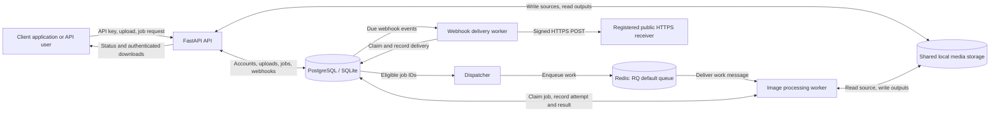
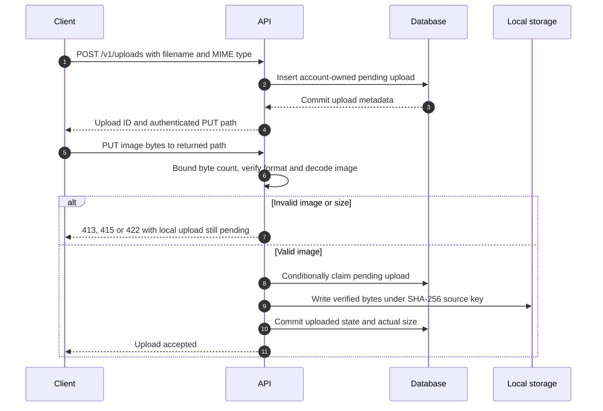
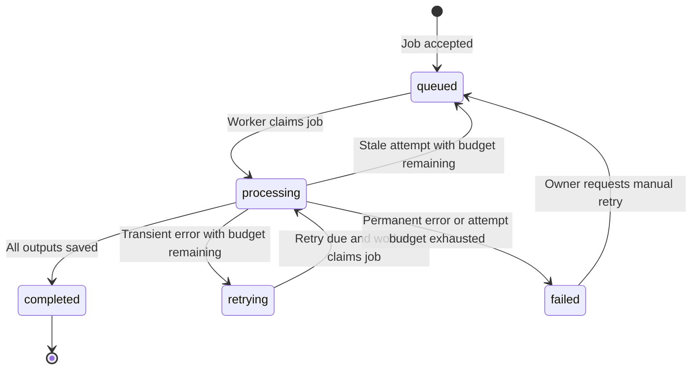
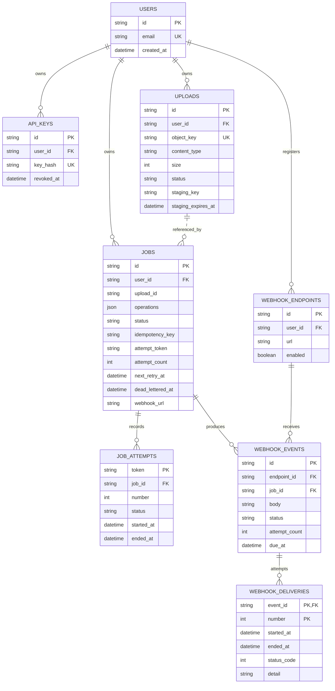
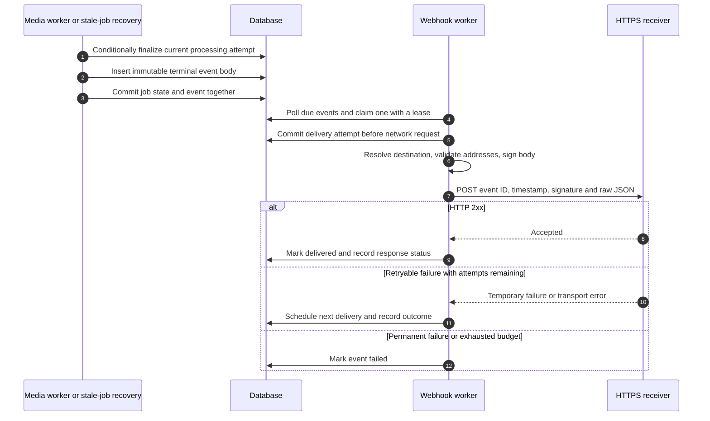
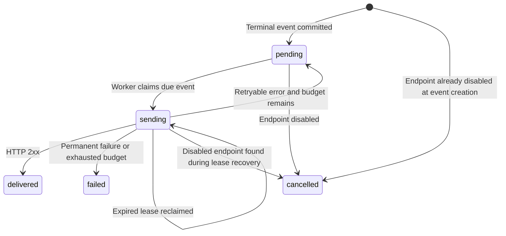
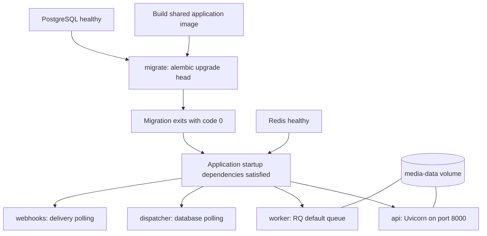

# Forge architecture

This document describes the implemented Async Media Processing Platform as reviewed on 7 November 2026. Forge accepts images, validates and stores their bytes, processes requested operations in background workers, and makes the results available through an authenticated API. It can also notify a registered HTTPS endpoint when a job completes or fails.

The current scope is an image-processing backend with local filesystem storage. Supported operations are resizing, thumbnails, format conversion and metadata extraction. The project has no application frontend, video pipeline or audio pipeline. Public deployment is managed separately by the project owner.

Diagrams use Mermaid and render in Markdown viewers with Mermaid support. Code identifiers and paths below are relative to the repository root.

## Contents

- [System overview](#1-system-overview)
- [Authentication and ownership](#2-authentication-and-ownership)
- [Upload lifecycle](#3-upload-lifecycle)
- [Job submission and processing](#4-job-submission-and-processing)
- [Job states, retries and crash recovery](#5-job-states-retries-and-crash-recovery)
- [Persistent data model](#6-persistent-data-model)
- [Webhook events and delivery](#7-webhook-events-and-delivery)
- [Filesystem layout and consistency](#8-filesystem-layout-and-consistency)
- [Container topology and startup](#9-container-topology-and-startup)
- [Configuration and migrations](#10-configuration-and-migrations)
- [API map](#11-api-map)
- [Reliability boundaries and tradeoffs](#12-reliability-boundaries-and-tradeoffs)
- [Verification and unfinished work](#13-verification-and-unfinished-work)

## 1. System overview



The database is the authority for job state, account ownership, retries and webhook delivery history. Redis carries processing messages. A Redis message is not proof that a job is running or has completed.

The API commits new jobs without contacting Redis. The dispatcher finds committed jobs and enqueues them later. This lets the API accept a job during a temporary Redis outage, provided the database is available. Processing resumes when dispatch becomes possible.

| Component | Responsibility | Main implementation |
| --- | --- | --- |
| API | Authentication, upload and job requests, status, output downloads, webhook management | `app/main.py` |
| Validation | Request shapes, operation limits, actual image validation | `app/schemas.py`, `app/uploads.py` |
| Database layer | Sessions, persistent records and ownership | `app/db.py`, `app/models.py` |
| Dispatcher | Find eligible jobs, publish work, recover stale attempts | `app/dispatcher.py` |
| Processing worker | Claim a job, decode its source and produce outputs | `app/worker.py` |
| Attempt management | Classify failures, calculate retries and fence completion | `app/job_attempts.py` |
| Webhook layer | Destination checks, signing and transactional event creation | `app/webhooks.py` |
| Delivery worker | Poll events, send notifications, record outcomes and retry | `app/webhook_worker.py` |
| Account administration | Create, list and revoke API keys | `app/accounts.py` |
| Maintenance | Inspect and remove eligible abandoned files | `app/storage_cleanup.py` |

## 2. Authentication and ownership

An administrator creates an account key through `python -m app.accounts EMAIL`, or the equivalent command inside the API container. A user can have several keys. The raw key is generated from random bytes and printed when it is created. The database stores its SHA-256 hash and an optional revocation timestamp.

Clients send the raw key in `X-API-Key`. The API hashes it, looks up a non-revoked key and resolves the owning user. Missing, invalid or revoked keys return HTTP 401. Uploads, jobs, outputs and webhook endpoints are checked against that user. Requests for another account's resource generally return HTTP 404.

Account email is an administrative identifier. There is no public signup, email verification or password-login flow. API keys and webhook signing secrets have separate purposes and must not be interchanged.

The public `/health` route is a basic liveness check. It does not verify database connectivity, Redis connectivity, worker availability or storage capacity. `/docs` exposes the interactive API documentation.

## 3. Upload lifecycle



### Request and acceptance

1. `POST /v1/uploads` accepts a filename, allowed content type and optional exact size. It returns an upload ID and a path such as `/v1/uploads/upl_.../content`.
2. The client sends raw bytes with `PUT` to that path and includes its API key. This is not a multipart form upload.
3. The API accumulates the request body with a 20 MiB limit. Validation and final storage run in a thread pool so image decoding does not occupy the asynchronous request loop.
4. Pillow checks the actual file format, frame count and dimensions, verifies file structure, then reopens and fully decodes the image.
5. A conditional database update matches the upload's previous key and status. Only the winning request may publish the accepted source.
6. The service writes the verified bytes to `sources/<upload_id>/<sha256>` before committing the database change. Later processing checks this checksum again.

| Rule | Current behavior |
| --- | --- |
| Input types | Single-frame PNG, JPEG and WebP |
| File size | Greater than zero and at most 20 MiB |
| Declared size | Optional, but must match the bytes when provided |
| Image dimensions | At most 16 million pixels |
| MIME validation | Actual format must match the content type in upload metadata |
| Invalid local upload | Rejected without accepting a source; the pending ticket can be corrected |
| Repeated successful PUT | HTTP 409; an accepted upload cannot be replaced through the API |
| Concurrent PUT requests | Only one conditional update wins |
| Paths | Generated storage keys; upload filenames do not determine filesystem paths |

Source access rejects traversal, symlinks and Windows reparse points beneath the configured storage root. The storage directory itself must remain private to trusted service processes. Validation is not an antivirus scan and does not provide request quotas or a total memory budget across simultaneous uploads.

New local uploads do not write a temporary staging file. Their initial `staging/<upload_id>` value is a metadata placeholder. Staging columns and maintenance logic remain for compatibility with older records. Legacy uploaded files are validated and promoted to a checksum source when first processed.

## 4. Job submission and processing

After an upload is accepted, the client submits `POST /v1/jobs` with its upload ID and a list of operations. A webhook URL is optional and must already be registered and enabled for that account. The API stores a `queued` job and returns HTTP 202.

### Idempotency

An optional `Idempotency-Key` header is unique within an account. Repeating the same key with the same upload, normalized operations and webhook URL returns the existing job. Reusing it with different content returns HTTP 409. A database uniqueness constraint also handles concurrent requests using the same key. Different accounts may use identical idempotency keys.

### Dispatch and claim

The dispatcher loops every 30 seconds by default. Each pass first recovers stale processing attempts, then selects up to 100 queued jobs or retrying jobs whose retry time has arrived. Eligible work is ordered by job creation time. The dispatcher publishes calls to `app.worker.process_job(job_id)` on RQ's `default` queue.

A job can be enqueued more than once before a worker claims it. On receipt, the worker performs a conditional SQL update that only matches an eligible job. The winner sets `processing`, records a start time, increments the attempt count and generates a fresh random attempt token. It inserts a `job_attempts` row and commits the claim. A duplicate message that cannot claim the job returns without processing it.

### Image operations

The worker reads the accepted bytes, verifies their checksum and opens the image with Pillow. Each operation starts from the original image. Operations are independent outputs, not a transformation chain.

| Operation | Behavior |
| --- | --- |
| `resize` | Produce the requested width and height; aspect ratio may change |
| `thumbnail` | Fit within the requested dimensions while preserving aspect ratio |
| `convert` | Save a copy in the requested PNG, JPEG or WebP format |
| `metadata` | Write JSON containing original width, height, format and mode |

Jobs accept 1 to 16 operations. Dimensions must be positive, each dimension must be at most 10,000, and the requested output area must be at most 16 million pixels. Conversion requires a format. Other image operations default to PNG when no format is supplied. JPEG output is converted to RGB before saving.

Outputs are named by their zero-based operation position, such as `0.png`, `1.webp` or `2.json`. Image-producing operations update job progress. Metadata operations do not publish a separate intermediate progress update. Successful finalization sets progress to 100.

Once complete, the client lists outputs using `GET /v1/jobs/{job_id}/outputs`, then downloads a returned path using the same API key. Output listing before completion returns HTTP 409. Output records are not stored in a separate database table; the API lists files under the successful attempt's directory.

## 5. Job states, retries and crash recovery



| Setting | Default | Purpose |
| --- | --- | --- |
| `dispatch_interval_seconds` | 30 seconds | Delay between dispatcher passes |
| `JOB_TIMEOUT_SECONDS` | 600 seconds | RQ job execution timeout |
| `JOB_RECOVERY_GRACE_SECONDS` | 120 seconds | Extra margin before stale-attempt recovery |
| `JOB_MAX_ATTEMPTS` | 3 | Total attempts in one retry budget, including the initial attempt |
| `JOB_RETRY_BASE_SECONDS` | 30 seconds | Initial transient-failure retry delay |
| `JOB_RETRY_MAX_SECONDS` | 300 seconds | Maximum exponential retry delay |

For transient errors, the delay after attempt number `n` is `min(maximum, base * 2^(n - 1))`. With default settings, the second attempt becomes eligible after 30 seconds and the third after another 60 seconds. Eligibility does not mean immediate execution; the next dispatcher pass and queue backlog add latency.

Connection errors, timeouts, RQ timeout exceptions and selected temporary filesystem errors are retryable. Other exceptions, including invalid media, are treated as permanent failures. Permanent failures stop immediately. A transient or timed-out attempt that exhausts its budget becomes `failed` with a `dead_lettered_at` timestamp. A dead letter is a database marker, not another Redis queue or job status.

The dispatcher considers a processing attempt stale when its start time is older than the configured timeout plus grace period. Stale attempts are marked `timed_out`. If budget remains, the job returns directly to `queued` because it has already waited through the timeout. Recovery scans at most 100 stale jobs per pass.

### Protecting results from an old worker

Every attempt has its own output directory and token. Progress and finalization updates require both `status = processing` and the matching current token. If recovery or a newer attempt has replaced that token, the old worker cannot change the job's result. It may still leave files in its abandoned directory, which maintenance can remove later.

`POST /v1/jobs/{job_id}/retry` lets the owner replay a failed job. It keeps the job ID and historical attempts but clears the current token, error, retry time and dead-letter marker, then starts a fresh attempt budget. Attempt numbers can therefore repeat across manual replays; tokens distinguish attempts.

## 6. Persistent data model



The diagram shows selected fields. The dotted uploads-to-jobs relationship is an application reference: `jobs.upload_id` is indexed but has no declared foreign key in the current model. The API checks upload existence and ownership. `jobs.webhook_url` is also a stored URL rather than an endpoint foreign key; terminal event creation resolves it using the job's owner and URL. Webhook events then store a real endpoint foreign key.

Important constraints include unique API key hashes, unique upload object keys, unique `(user_id, idempotency_key)` pairs for jobs and unique `(user_id, url)` pairs for webhook endpoints. Webhook delivery identity is the composite `(event_id, number)` key. Attempt tokens are primary keys for processing history.

Indexes support account lookups, job status and retry-time queries, dead-letter listing, job attempt history and due webhook polling. PostgreSQL is used by Compose. SQLite is the default when running directly on the host without a database URL override. Application ownership checks are still necessary regardless of database constraints.

## 7. Webhook events and delivery



### Registration and event creation

The owner registers a public HTTPS URL with `POST /v1/webhooks`. The response returns a signing secret once. Listing endpoints does not reveal it. Duplicate URLs within an account return HTTP 409. URLs are immutable. Disabling an endpoint retains its record and reserves that URL for the account.

A job with a registered webhook produces a `job.completed` or `job.failed` event when it reaches a terminal state. Intermediate processing retries do not emit events. A manually replayed failed job can later produce a different terminal event with a new ID.

The terminal job update, attempt outcome and event insertion occur in one database transaction. This is a transactional outbox: a committed terminal state and its event are recorded together. The media worker never waits for the receiver's HTTP response.

An event contains its ID, event type, creation timestamp and data containing the job ID, upload ID and status. Completed events include a relative authenticated `outputs_url`; failed events include the error message. The receiver resolves output paths against the Forge API base URL and authenticates separately when retrieving results. The stored event body is reused unchanged across delivery retries.

### Signing and destination restrictions

The endpoint signing secret is derived using HMAC-SHA256 from `WEBHOOK_MASTER_SECRET` and `forge-webhook-v1:<endpoint_id>`. The returned hexadecimal secret string is used as UTF-8 bytes when signing deliveries. It is not hex-decoded for that operation.

```text
message   = timestamp_as_text + "." + exact_raw_request_body
signature = "sha256=" + hex(HMAC_SHA256(endpoint_secret_as_utf8, message))
```

The HTTP headers are `X-Webhook-Id`, `X-Webhook-Timestamp` and `X-Webhook-Signature`. Receivers should verify the signature using a constant-time comparison, reject stale timestamps and deduplicate by event ID. The README contains a verification example. The producer does not enforce the receiver's replay policy.

Registration and each delivery check the destination. Only HTTPS on port 443 with public IPv4 DNS answers is supported. User information, fragments, whitespace/control characters, private addresses, loopback, link-local, reserved and multicast addresses are rejected. Mixed public/private DNS results are rejected. Delivery connects to a checked numeric address while preserving the original hostname for TLS and the Host header. Redirects are disabled. The connection timeout is three seconds and the read timeout is seven seconds; these are transport timeouts, not an absolute wall-clock deadline for DNS and the entire request.

### Delivery state and retries



The webhook worker polls up to 50 due events per pass, sends them sequentially and sleeps one second between passes. Delivery attempts use a 60-second database lease and a conditional update so concurrent workers cannot normally claim the same attempt. Completion updates also match the attempt number. An expired lease can be reclaimed after a crash, with the previous attempt recorded as interrupted.

HTTP 408, 425, 429 and 5xx responses, plus eligible transport errors, retry after 30, 120, 600 and 3,600 seconds. The initial request counts toward the five-attempt maximum. Other HTTP errors, redirects, unsafe destinations and TLS certificate failures stop delivery. A failed delivery does not change the processing job's result.

Delivery can be duplicated if the receiver accepts a request but the sender crashes before recording success. Event IDs and bodies remain stable so receivers can deduplicate. Disabling an endpoint cancels pending events; an already claimed request may still finish. Registration checks destination safety but does not prove domain ownership.

## 8. Filesystem layout and consistency

```text
LOCAL_STORAGE_PATH/
  sources/
    upl_<id>/
      <sha256>
  outputs/
    job_<id>/
      <attempt_token>/
        0.png
        1.webp
        2.json
  uploads/
    <legacy_source_key>
  staging/
    <legacy_staging_key>
```

The accepted source preserves the validated original bytes. Image outputs are newly encoded files. Metadata outputs are JSON. Separate attempt directories let the API expose only the successful attempt, even when another worker leaves abandoned output behind.

Database and filesystem writes are not a single atomic transaction. Source acceptance writes a file before committing its metadata. A crash between those steps can leave an unreferenced file. Processing similarly writes output files before finalizing its database state. Conditional updates prevent stale attempts from becoming the published result, while maintenance handles eligible leftovers.

The cleanup command defaults to a dry run. `python -m app.storage_cleanup --apply` enables deletion. It examines known generated paths tied to database upload and attempt records. It preserves accepted sources, the current attempt's files, completed attempt files and unknown filenames. Old unreferenced source files and failed, timed-out or transient-error attempt files require a one-day age margin. Legacy staging uses recorded expiry plus one day, or creation plus eight days when no expiry was recorded. Upload row updates coordinate cleanup with concurrent source acceptance.

Cleanup is not a general scan of every file on disk. It has no automatic policy for deleting successful outputs, normal source files or database history. No maintenance scheduler is included yet. Backups must include both database state and media files; the webhook master secret must be backed up securely as well.

## 9. Container topology and startup



`compose.yaml` runs seven services, including the one-time migration service. API, worker, dispatcher, webhooks and migrate share the application image and configuration. The application image uses Python 3.12 and runs as the unprivileged `forge` user. The build context excludes local secrets, media, backups and tests.

| Service | Command or role | Persistence |
| --- | --- | --- |
| `migrate` | `alembic upgrade head`; must exit successfully | PostgreSQL schema |
| `api` | Uvicorn serving `app.main:app` | Shared media volume and PostgreSQL |
| `worker` | Normal Linux RQ worker on `default` | Shared media volume and PostgreSQL |
| `dispatcher` | `python -m app.dispatcher` | Job state in PostgreSQL; messages in Redis |
| `webhooks` | `python -m app.webhook_worker` | Delivery state in PostgreSQL |
| `postgres` | PostgreSQL 16 | `postgres-data` volume |
| `redis` | Redis 7 with append-only persistence | `redis-data` volume |

The API listens on host `127.0.0.1:8000`, PostgreSQL on `127.0.0.1:55432` and Redis on `127.0.0.1:6379`. Containers reach the database and Redis by Compose service names. Compose explicitly uses PostgreSQL even if host-only development uses SQLite. The shared media root in application containers is `/srv/forge/data/storage`.

Long-running services use `unless-stopped` restart policies. Application container logs rotate at 10 MB with three files. The processing worker has an 11-minute shutdown grace period to allow a default ten-minute job to finish; review that value if job timeouts are increased. The webhook process has a 20-second shutdown grace period. Application services start only after migration success and Redis health checks. API health checks call `/health`.

Named volumes survive container replacement and ordinary `docker compose down`. Removing volumes deletes their contents. Host `data/storage` is not automatically copied into the container media volume, and host SQLite data is not automatically imported into PostgreSQL. Existing installations must plan those transfers explicitly.

## 10. Configuration and migrations

Pydantic settings read environment variables and the local `.env`. Relevant settings include `DATABASE_URL`, `LOCAL_STORAGE_PATH`, `REDIS_URL`, the job retry/timeout settings and `WEBHOOK_MASTER_SECRET`. Compose supplies its internal connection URLs and propagates its configured retry values. `.env` is ignored by Git and excluded from the image.

The signing master must contain at least 32 bytes and remain consistent between API and webhook worker processes. Changing it changes all derived endpoint signing secrets. Automated endpoint secret rotation is not implemented.

Alembic migrations provide the upgrade sequence:

| Revision | Purpose |
| --- | --- |
| `0001_initial` | Initial uploads and jobs |
| `0002_accounts` | Users, API keys and ownership, including legacy ownership migration |
| `0003_job_attempts` | Current processing attempt tokens and timing |
| `0004_job_retries` | Persistent attempt history, retry schedules and dead-letter metadata |
| `0005_uploads_webhooks` | Upload staging metadata and durable webhook tables |

Use the migration files as the authoritative schema history. Existing data must be backed up before upgrades. Later migrations intentionally reject destructive downgrade paths and direct administrators to restore a backup. The README explains how to handle prototype databases that predate Alembic tracking.

## 11. API map

All `/v1` routes below require `X-API-Key` and enforce account ownership where a resource ID is supplied.

| Method and path | Purpose |
| --- | --- |
| `GET /health` | Public process liveness |
| `POST /v1/uploads` | Create pending upload metadata |
| `PUT /v1/uploads/{upload_id}/content` | Validate and accept local bytes |
| `POST /v1/jobs` | Create or resolve an idempotent job |
| `GET /v1/jobs/dead-letters` | List exhausted jobs |
| `GET /v1/jobs/{job_id}` | Read processing state |
| `GET /v1/jobs/{job_id}/attempts` | Read processing history |
| `POST /v1/jobs/{job_id}/retry` | Replay a failed processing job |
| `GET /v1/jobs/{job_id}/outputs` | List completed output files |
| `GET /v1/jobs/{job_id}/outputs/{filename}` | Download an output |
| `POST /v1/webhooks` | Register a destination and obtain its secret |
| `GET /v1/webhooks` | List account endpoints |
| `DELETE /v1/webhooks/{endpoint_id}` | Disable an endpoint |
| `GET /v1/jobs/{job_id}/webhooks` | Read event and delivery history |

Dead letters, processing attempts, endpoints and webhook history support `limit` and `offset` pagination. The API provides no standalone source-download endpoint or general upload/job deletion API.

## 12. Reliability boundaries and tradeoffs

| Design choice | Benefit | Boundary |
| --- | --- | --- |
| Commit jobs before dispatch | Accepted work survives temporary queue outages | Polling adds latency; database availability is still required |
| Re-enqueue eligible jobs | A later pass can recover missing work messages | Backlogs can accumulate duplicate messages; fairness and deduplication need improvement |
| Conditional worker claims | Duplicate messages usually perform no extra processing | Recovery can overlap with an old live process; token fencing protects publication |
| Separate attempt directories | Old attempts cannot overwrite current output paths | Abandoned files need maintenance |
| Terminal event in the job transaction | Completion and notification intent commit together | Filesystem writes remain outside that transaction |
| Independent webhook worker | Slow receivers do not delay media processing | Delivery is finite-retry and may duplicate after a crash |
| Shared local storage | Simple operation without an external object store | Multi-host scaling requires coordinated shared storage and its own failure strategy |
| SQLite option | Lightweight local development | PostgreSQL is preferable for concurrent container services |

There is no exactly-once processing or exactly-once notification promise. The design combines repeated dispatch, conditional claims, attempt fencing and receiver deduplication to tolerate common interruptions. A completed media job can coexist with a failed webhook event.

## 13. Verification and unfinished work

The last local verification on 7 November 2026 passed all 23 automated tests with Redis integration enabled. The running Compose stack also passed an actual upload, queued image resize and authenticated download. A previous restart probe confirmed that the generated output remained available after restarting the API and worker. These results describe the checked local configuration, not a production load or security certification.

| Verification source | Coverage |
| --- | --- |
| `tests/test_flow.py` | Authentication, ownership, idempotency, image outputs, retries and recovery fencing |
| `tests/test_upload_safety.py` | Invalid media, size and pixel limits, concurrent acceptance, legacy sources, path checks and cleanup |
| `tests/test_webhooks.py` | Real local TLS receiver, independent signature checks, retries, redirects, unsafe destinations, ownership, transaction rollback and concurrent claims |
| `tests/test_redis_integration.py` | Real Redis and separate worker processes, transient retry and killed-worker recovery |
| `scripts/compose_smoke.py` | Actual container API upload, background processing, download and optional restart persistence |

The Redis tests require `TEST_REDIS_URL`; without it those three tests are skipped. They must run against isolated test database/storage locations when invoked separately. The Compose probe retains a small sample job and its files, then revokes its temporary account key. See README for the exact commands.

The implemented backend is a working local MVP. The following are still open engineering items:

- Monitoring, aggregate metrics and failure alerts.
- Request rate limits, per-account storage quotas and broader resource controls.
- Bounded queue deduplication and fairness during heavy backlogs.
- Automated CI execution and scheduled backup/cleanup jobs, including restore drills.
- Manual webhook event replay and endpoint signing-secret rotation.
- Public hosting, TLS, production credentials and deployment-specific operations, handled by the project owner.

A frontend dashboard, video/audio processing and multi-host storage are optional scope expansions. They are not components of the current implementation.
